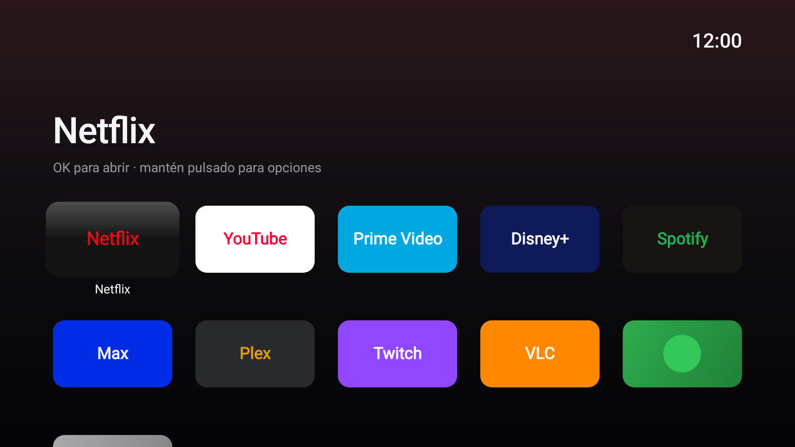
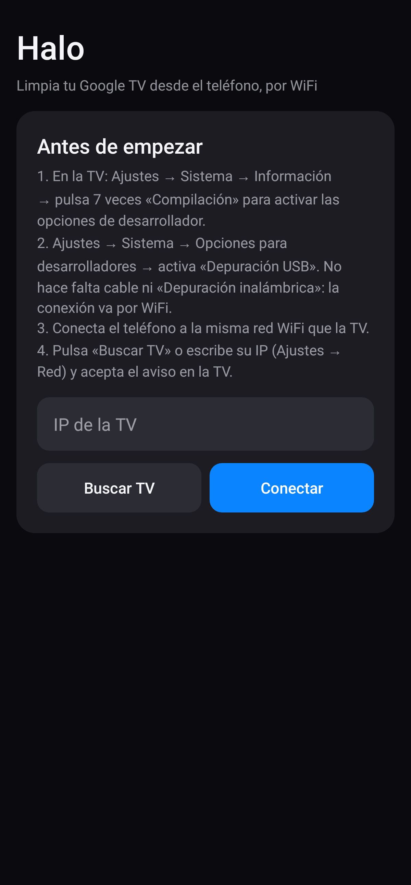
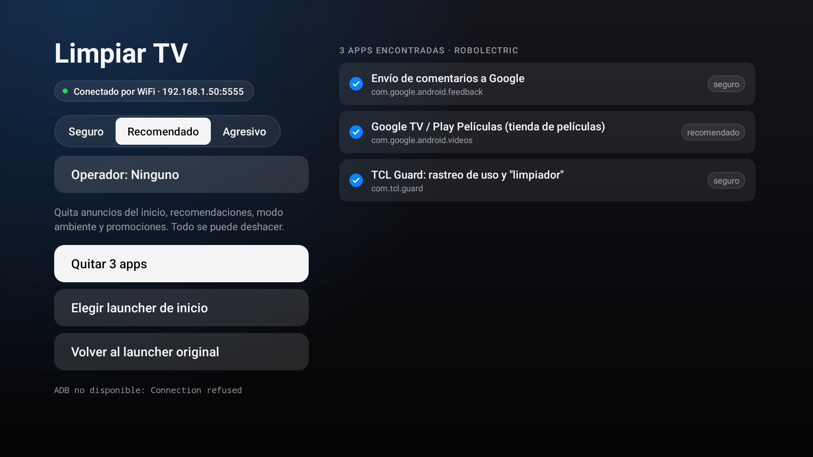
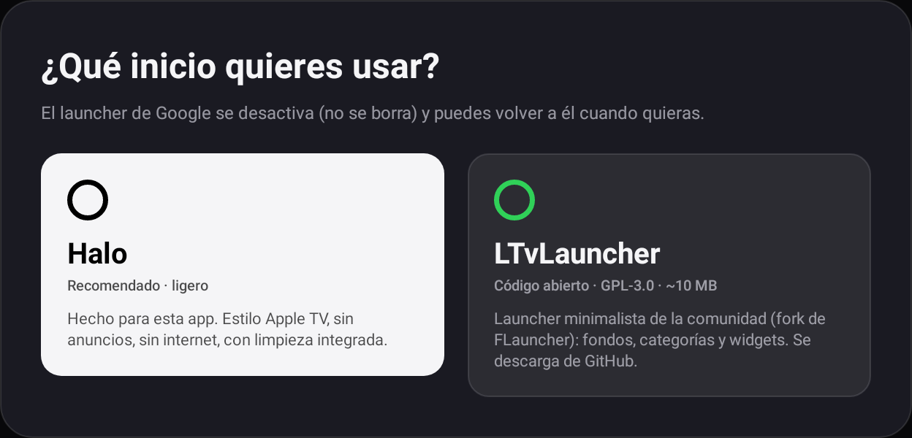

# DebloatTV + Halo Launcher

Limpia tu Smart TV con **Google TV / Android TV** y cambia el launcher de Google, lleno de anuncios y recomendaciones, por **Halo**: un launcher ligero (≈90 KB, sin dependencias) inspirado en Apple TV. También puedes elegir **LTvLauncher**, un launcher de código abierto de la comunidad.



El diseño está en Figma: [Halo – rediseño TV](https://www.figma.com/design/cOhkyFGCndvYC2di07C1EX) (pantalla de inicio, Limpiar TV, selector de launcher y componentes).

**Una sola app universal: `dist/halo.apk`.** Al abrirla detecta dónde está:

- **En la TV** es el launcher Halo y además **limpia la TV desde la propia TV** (tarjeta ⚙ → Limpiar TV): no hace falta teléfono ni PC.
- **En el teléfono** es el control remoto: se conecta a la TV por WiFi, la limpia y **se instala a sí misma en la TV** como launcher.


- **Al conectarse elige qué usar:** reconoce la marca y el decodificador del operador y propone su perfil (VTR, Claro, Entel, Movistar, DIRECTV, Mundo, WOM, GTD o ninguno), que puedes cambiar con el botón **Operador**.
- **Debloater** (`debloater/`): quita las apps preinstaladas por niveles de riesgo, detecta la marca del televisor y guarda un backup de todo lo que toca para poder deshacerlo.
- **Halo Launcher** (`launcher/`): cuadrícula limpia de apps en 16:9, foco con elevación y brillo, nombre bajo la app enfocada, lavado de color de fondo que sigue a la app, reloj, reordenar con "tembleque" y ocultar apps. Sin anuncios, sin recomendaciones, sin conexión a internet.

Todo es **reversible**: nada se borra de la partición del sistema. Las apps se quitan solo para el usuario (`pm uninstall --user 0`) y los launchers se desactivan (`pm disable-user`), así que un restablecimiento de fábrica también lo devuelve todo a como estaba.

---

## Opción A: solo con la TV (recomendada, p. ej. TCL)

Solo necesitas instalar **`dist/halo.apk`** en la TV. Formas de hacerlo sin PC:

- **Memoria USB:** copia el APK a un pendrive, conéctalo a la TV y ábrelo con el gestor de archivos (en TCL: *Gestor de archivos* o *Media Center*). Si no tienes gestor, instala *File Commander* o *X-plore* desde Play Store.
- **Desde el teléfono:** con la app *Send Files to TV* (Play Store en el móvil y en la TV).
- **Con la app Downloader** (Play Store de la TV), escribiendo la URL del APK.

La primera vez Android pedirá permitir **instalar apps desconocidas** para la app con la que lo abras: acéptalo.

Después, en Halo: ve a la última tarjeta (**⚙ Ajustes**) → **Limpiar TV**.



Halo se conecta al ADB de la propia TV. Basta con activar **Depuración USB** (no hace falta cable ni *Depuración inalámbrica*): Halo prueba `127.0.0.1:5555` y, si no responde, la IP WiFi/Ethernet de la propia TV, igual que haría un móvil.

- **Si funciona (modo automático):** la TV mostrará *¿Permitir depuración?*; marca **Permitir siempre** y acepta con el mando. Luego eliges el nivel, pulsas **Quitar N apps** y **Elegir launcher de inicio** (Halo o LTvLauncher). Todo se deshace con **Restaurar todo lo quitado** y **Volver al launcher original**.
  Para que funcione: Ajustes → Sistema → Información → pulsa 7 veces *Compilación*, y en *Opciones para desarrolladores* activa **Depuración USB** (y **Depuración por red** si aparece).
- **Si tu TV no lo permite (modo manual):** Halo te muestra las apps basura que tiene tu TV; pulsa cada una para abrir sus ajustes y elige **Desactivar**. Y activa **Botón Inicio → Halo**: un servicio de accesibilidad que, cuando el botón HOME abre el launcher de TCL/Google, abre Halo encima. Así Halo queda como inicio sin ADB.

> Si el interruptor de *Halo: botón Inicio* aparece bloqueado (Android 13+ lo hace con las apps instaladas desde un archivo), ve a Ajustes → Apps → Halo, pulsa ⋮ / Más opciones → **Permitir ajustes restringidos** y vuelve a intentarlo.
>
> Si usas *Botón Inicio → Halo* y luego quieres volver al launcher original, desactiva el servicio en Ajustes → Accesibilidad.



### Launcher alternativo: LTvLauncher

[LTvLauncher](https://github.com/leanbitlab-org/LtvLauncher) es un launcher de código abierto (GPL-3.0) para Android TV, derivado de FLauncher y mantenido activamente: fondos, categorías, widgets, sin anuncios. Pesa unos 10 MB. Si lo eliges, la app descarga la última versión desde sus releases de GitHub (la variante para el procesador de tu TV), la instala y la deja como inicio. Halo sigue instalado para abrir **Limpiar TV** desde la lista de apps.

## Opción B: desde el teléfono

Instala el mismo **`dist/halo.apk`** en tu teléfono Android: allí se abre en modo control remoto y habla directamente con la TV por WiFi.

1. **En la TV:** Ajustes → Sistema → Información → pulsa OK 7 veces sobre *Compilación* hasta que salga "Ya eres desarrollador".
2. **En la TV:** Ajustes → Sistema → Opciones para desarrolladores → activa **Depuración USB** (y **Depuración por red** si existe).
   No hace falta la opción *Depuración inalámbrica* de Android 11+: la app se conecta igual que `adb connect IP:5555`. En la mayoría de televisores, con *Depuración USB* activada ya se acepta la conexión por la red.
3. **En el teléfono:** instala `halo.apk` (permite "instalar apps desconocidas" cuando te lo pida) y conéctalo a la misma WiFi que la TV.
4. Abre Halo → **Buscar TV** → **Conectar**. En la TV saldrá *¿Permitir depuración?*: marca **Permitir siempre** y acepta.
5. Revisa el **Operador** propuesto, elige el nivel, pulsa **Quitar seleccionadas** y luego **Instalar Halo** (el teléfono copia la app a la TV).

Para deshacer, en la misma app: **Restaurar todo** y **Volver al original**.

> **Si "Buscar TV" no la encuentra:** tu TV no abre el puerto 5555 solo con *Depuración USB*. Prueba a activar *Depuración por red* si tu modelo la tiene. Si no, conecta la TV una vez a un PC por USB y ejecuta `adb tcpip 5555`; desde ese momento la app funciona por WiFi hasta que reinicies la TV.

## Opción C: desde un PC con los scripts

## 1. Preparar la TV

1. **Ajustes → Sistema → Información → Compilación de Android TV**: pulsa OK 7 veces hasta que salga "Ya eres desarrollador".
2. **Ajustes → Sistema → Opciones para desarrolladores**: activa **Depuración USB** (y **Depuración por red/inalámbrica** si aparece).
3. Apunta la IP de la TV: **Ajustes → Red e Internet → (tu red)**.
4. Instala [Android platform-tools](https://developer.android.com/tools/releases/platform-tools) en tu PC para tener `adb`.

La primera vez que te conectes, la TV pedirá permiso: marca *Permitir siempre* y acepta.

## 2. Debloat

Linux / macOS:

```bash
cd debloater
./debloat.sh -i 192.168.1.50 -n          # simulación: muestra qué se quitaría
./debloat.sh -i 192.168.1.50             # nivel "recomendado"
```

Windows (doble clic en `debloat.bat` o desde una terminal):

```powershell
cd debloater
.\debloat.bat -Ip 192.168.1.50 -DryRun
.\debloat.bat -Ip 192.168.1.50 -Level recomendado
```

### Niveles

| Nivel | Qué quita | Riesgo |
|---|---|---|
| `seguro` | Telemetría, informes de errores, Play Juegos, YouTube Music, impresión, demos de tienda | Ninguno |
| `recomendado` *(por defecto)* | Lo anterior + tienda de películas, recomendaciones/anuncios del home, modo ambiente, promos del fabricante | Bajo |
| `agresivo` | Lo anterior + Asistente de Google, Chromecast integrado, Live Channels, TTS y apps de streaming preinstaladas | **Pierdes la voz y el cast** |

Hay listas para **Google** (siempre se aplica), **Sony, TCL, Xiaomi, Hisense y Philips** (se elige sola según la marca). Están en `debloater/lists/` y se pueden editar.

Paquetes críticos como Play Store, Play Services, el teclado o los ajustes están protegidos y no se tocan nunca, aunque los pongas en una lista.

### Revisar tu TV a mano

```bash
./debloat.sh -i 192.168.1.50 --scan
```

Muestra las apps del sistema que no aparecen en ninguna lista. Si quieres quitar alguna, crea un archivo `mis-apps.txt`:

```
recomendado  com.fabricante.appbasura   Descripción
```

y ejecuta `./debloat.sh -i 192.168.1.50 --list mis-apps.txt`.

### Deshacer

Todo lo que se quita queda registrado en dos sitios: en `debloater/backups/` (PC) y **dentro de la propia TV** (`/sdcard/DebloatTV/backup.txt`). La copia de la TV la comparten los scripts, Halo y la app del teléfono, así que puedes deshacer desde cualquiera de ellos aunque lo hicieras con otro:

```bash
./debloat.sh -i 192.168.1.50 --restore tv                                   # copia de la TV
./debloat.sh -i 192.168.1.50 --restore backups/chromecast-20261025-1430.txt  # un backup del PC
```

```powershell
.\debloat.bat -Ip 192.168.1.50 -Restore tv
```

## 3. Cambiar el launcher por Halo

```bash
./debloat.sh -i 192.168.1.50 --launcher        # Halo
./debloat.sh -i 192.168.1.50 --launcher ltv    # LTvLauncher (código abierto, se descarga de GitHub)
```

```powershell
.\debloat.bat -Ip 192.168.1.50 -Launcher
.\debloat.bat -Ip 192.168.1.50 -Launcher -Apk ltv
```

Instala el launcher, lo marca como pantalla de inicio y desactiva el launcher de stock (Google TV, Android TV, PatchWall de Xiaomi y el de cualquier marca, que se detecta solo). Después **comprueba** qué abre de verdad el botón Inicio.

Para volver al launcher original:

```bash
./debloat.sh -i 192.168.1.50 --restore-launcher
adb uninstall com.carmelita.halo      # opcional
```

### TCL con Google TV (y otras TV que no dejan cambiar el inicio)

En algunas TCL con Google TV (Android 12), Android **ignora** el cambio de app de inicio y, si se desactiva el launcher de Google, el botón Inicio cae en una pantalla de recuperación. Cuando las herramientas lo detectan, **deshacen el cambio** (el launcher de Google vuelve a estar activo) y activan automáticamente por ADB **Botón Inicio → Halo**: un servicio de accesibilidad que abre Halo cada vez que pulsas Inicio. Verás un instante el inicio de Google antes de Halo; es lo máximo que permite esa TV sin root.

> **Nunca se desactiva `com.google.android.tungsten.setupwraith`:** en estas TV guarda la red WiFi y desactivarlo la borra (la TV se queda sin WiFi ni ADB). Versiones anteriores de esta herramienta sí lo desactivaban; si la usaste, `--restore-launcher` (o «Volver al launcher original» en las apps) lo reactiva.
>
> Fuente: [amfakh/tcl-g09-debloat](https://github.com/amfakh/tcl-g09-debloat), que documenta este comportamiento en una TCL Smart TV Pro. La lista `lists/tcl.txt` se basa en ella.

### Usar Halo

| Acción | Mando |
|---|---|
| Abrir app | OK |
| Opciones (mover, ocultar, info, desinstalar) | Mantener OK, o botón ☰ Menú |
| Mover app | Opciones → Mover, flechas para colocarla y OK para soltarla |
| Ver apps ocultas | Opciones → Ver apps ocultas |
| Volver arriba | Atrás o HOME |
| Limpiar TV, ajustes del sistema, botón Inicio | Última tarjeta (engranaje) |

## 4. Compilar Halo tú mismo (opcional)

Requiere JDK 17+ y el Android SDK (o Android Studio).

```bash
cd launcher
./gradlew assembleRelease
# APK en launcher/app/build/outputs/apk/release/app-release.apk
```

GitHub Actions compila el APK universal en cada cambio (pestaña *Actions → Compilar APK → Artifacts*). Empaqueta las listas de `debloater/lists/`.

El APK release está firmado con la clave de depuración para que se pueda instalar directamente. Si compilas tu propia versión con otra clave, desinstala antes la de `dist/` (`adb uninstall com.carmelita.halo`), porque Android no deja actualizar una app firmada con una clave distinta.

## Decodificadores de operadores (Chile)

Las herramientas reconocen los decodificadores Android TV de los operadores chilenos (`debloater/lists/dispositivos.txt`) y, en el nivel **recomendado**, **quitan las apps del operador** para dejarlos lo más cerca posible de Android TV stock (`lists/operadores.txt` y una lista por operador). Las listas usan comodines (`com.tivo.*`) porque los nombres exactos varían por firmware, e incluyen los paquetes reales comprobados de cada app (p. ej. `com.tivo.androidtv.llacl` de VTR Play TV, `cl.entel.enteltv`, `cl.movistarplay`, `br.com.claro.now.smarttvclient`). El launcher del operador se cambia con **Elegir launcher de inicio**.

El perfil se elige solo cuando se reconoce el decodificador. Para operadores sin decodificador Android propio (Movistar, DIRECTV) o si usas su app en otro TV box, elígelo a mano: botón **Operador** en la app, o `--operador movistar` / `-Operador Movistar` en los scripts.

> Al quitar las apps del operador **dejarás de ver sus canales en ese equipo**. Es reversible: «Restaurar todo lo quitado» (o `--restore tv`) las devuelve, y un restablecimiento de fábrica también. En una TV normal no se aplica ningún perfil salvo que lo elijas.

| Operador | Equipo | Fabricante · chip · Android TV | Notas |
|---|---|---|---|
| VTR | d-BOX Smart (SEI500L) | SEI Robotics · S905X2 · 9→10 | Quita TiVo/TV Smart y apps de VTR |
| VTR | TV Stick (SEI700L) | SEI Robotics · S905Y4 · 11 | Ídem |
| Claro | Claro TV+ (B866V2) | ZTE · S905X2 · 10→12 | Quita apps de Claro. No cambies el firmware |
| Entel | Deco Entel TV 4K (DIW585) | S905X · 9→10 | Quita apps de Entel |
| Entel | Deco Entel TV V2 (DIW586) | SDMC · S905X4 · 11→12 | Quita apps de Entel |
| Entel | Audio Box (VSB3930) | Sagemcom · BCM72180 · 11 | Quita apps de Entel; no toca audio ni micrófono |
| Mundo | Mundo GO! | Android TV | Quita MundoGo TV |
| WOM | WOM TV Box (SEI500W) | SEI Robotics · 9 | Quita WOM TV (servicio cerrado en 2023) |
| GTD / Telsur | GTD TV Box (SEI700GTD) | SEI Robotics · S905Y4 · 12 | Quita apps de GTD/Telsur |
| Movistar | Decos IPTV (Technicolor, Kaon, Arris, Skyworth) | — | No son Android TV: ADB no puede conectarse. Perfil a mano para quitar Movistar TV de un TV box |
| DIRECTV | — | — | Perfil a mano para quitar DGO |

Para apps del fabricante (SEI Robotics, ZTE, SDMC, Sagemcom) no hay listas comprobadas y quitarlas a ciegas puede romper el mando, el HDMI-CEC o las actualizaciones, así que no se tocan. Si tienes uno de estos equipos, ejecuta `./debloat.sh -i IP --scan` y comparte el resultado para afinar su lista.

Fuentes: [androidtv-guide.com](https://www.androidtv-guide.com) (fichas de VTR, Claro y Entel), [Entel: Audio Box](https://ayuda.entel.cl/hc/es-419/articles/49564023770643--Qu%C3%A9-es-Audio-Box-y-c%C3%B3mo-obtenerlo-con-Entel-TV), [pisapapeles.net](https://pisapapeles.net/review-decodificador-4k-entel-con-android-tv/), [tavilatam.com](https://tavilatam.com/chile-vtr-esta-distribuyendo-un-nuevo-decodificador-stick-para-su-servicio-de-tv-paga/), [tumundo.cl](https://www.tumundo.cl/blog/mundo-telecomunicaciones-mejora-la-experiencia-de-sus-clientes-con-un-upgrade-a-su-dispositivo-mundo-go/), [Chócale: cierre de WOM TV](https://chocale.cl/2023/04/wom-cierre-servicio-wom-tv-traspaso-zapping/), [Movistar Chile: decodificador IPTV](https://ww2.movistar.cl/hogar/television/decodificador/).

## Estructura

```
debloater/
  debloat.sh       Linux / macOS
  debloat.ps1      Windows (PowerShell)
  debloat.bat      Atajo para Windows
  lists/*.txt      Listas de paquetes por marca y nivel
launcher/          App universal Halo (Java, sin dependencias): launcher + Limpiar TV en la TV,
                   control remoto por WiFi en el teléfono
shared/            Cliente ADB y reglas de limpieza
dist/halo.apk      APK universal listo para instalar
```

## Aviso

Úsalo bajo tu responsabilidad. Los nombres de paquete cambian entre modelos y versiones de firmware: ejecuta siempre primero con `-n` / `-DryRun` y revisa la lista. Si algo deja de funcionar, usa `--restore` con el backup correspondiente.
